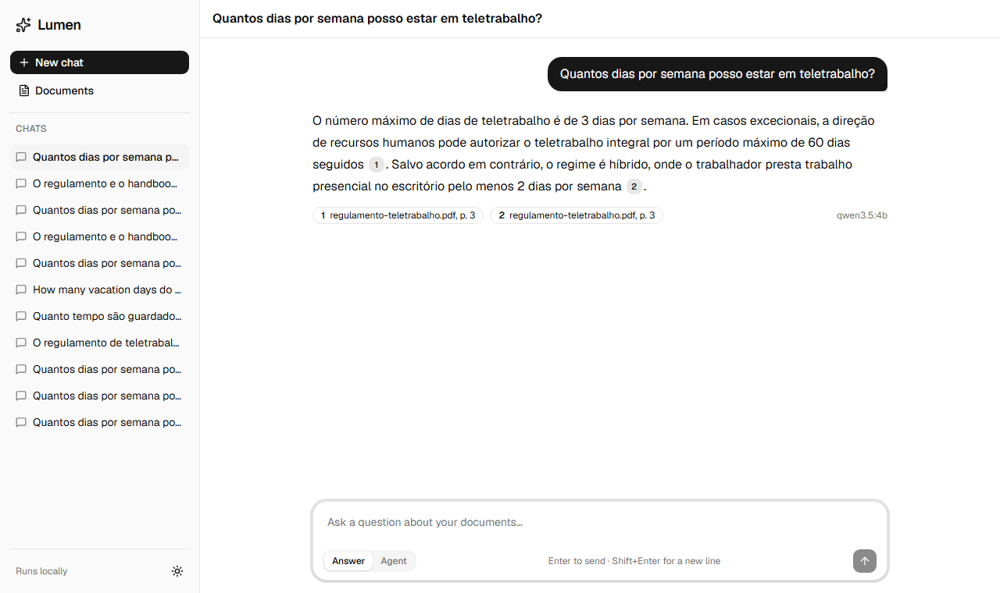
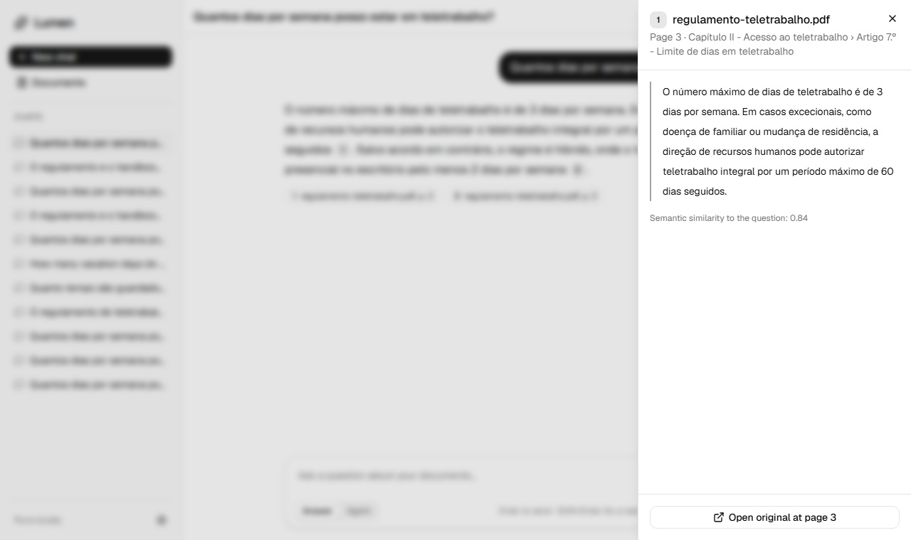
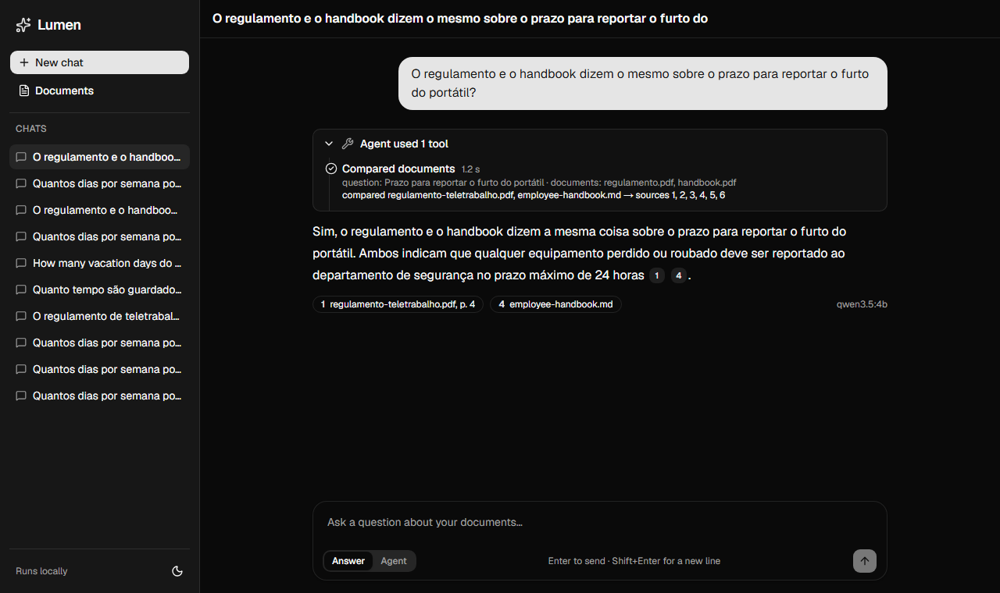
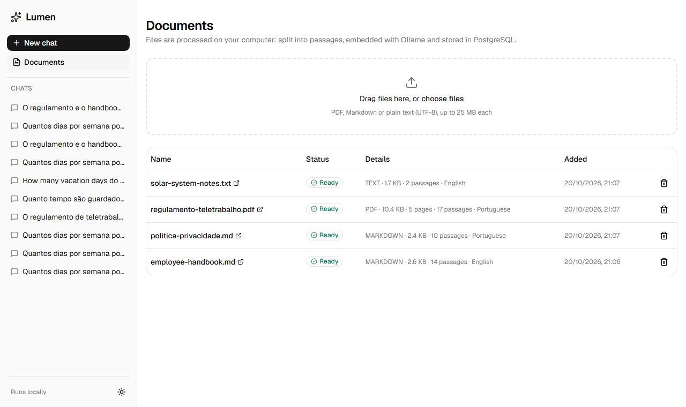
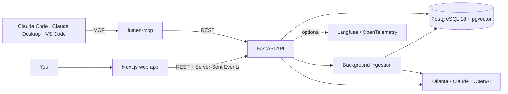

# Lumen

[](https://github.com/rodrigomachadoipvc/lumen-ai-docs/actions/workflows/ci.yml)
[](LICENSE)


**Ask questions about your documents and get answers you can check.**

Upload PDFs, Markdown or text files, then ask questions in Portuguese or English. Lumen finds the
relevant passages, writes an answer that uses **only those passages**, and cites each claim with a
clickable `[n]`. Each citation opens the exact passage and page. When the documents don't contain
the answer, Lumen says so instead of guessing.

Everything runs on your computer: PostgreSQL in Docker, a local model through Ollama, no cloud
account and no cost. You can switch to Claude or GPT by setting one variable if you prefer.



<table>
  <tr>
    <td width="50%"></td>
    <td width="50%"></td>
  </tr>
  <tr>
    <td align="center"><sub>Every citation opens the exact passage, page and section</sub></td>
    <td align="center"><sub>Agent mode: several tool calls for harder questions</sub></td>
  </tr>
</table>

---

## Contents

- [Features](#features)
- [Quick start](#quick-start)
- [Using Lumen](#using-lumen)
- [How it works](#how-it-works)
- [Configuration](#configuration)
- [Use Lumen from Claude Code, Claude Desktop or VS Code (MCP)](#use-lumen-from-claude-code-claude-desktop-or-vs-code-mcp)
- [Quality: evaluations](#quality-evaluations)
- [Development](#development)
- [Troubleshooting](#troubleshooting)
- [Project status](#project-status)

## Features

- **Grounded answers with citations.** Each claim links to the passage, page and section it came
  from, and the original PDF opens at the right page.
- **"I don't know" when the evidence is weak.** Questions the documents don't answer are refused
  instead of guessed.
- **Hybrid search.** PostgreSQL full-text search (finds exact terms like "artigo 12.º") and pgvector
  semantic search (finds paraphrases), merged with Reciprocal Rank Fusion.
- **Agent mode.** For comparisons and multi-part questions, the model searches, reads sections and
  compares documents in several steps, and each step is shown in the UI.
- **Portuguese and English.** Language-aware search, and the answer comes back in the language of
  the question.
- **Local first.** Ollama with `qwen3.5:4b` and `qwen3-embedding:0.6b` by default. Claude
  (`claude-opus-5-5`) and OpenAI are optional.
- **MCP server.** Use your documents from Claude Code, Claude Desktop or VS Code.
- **Measured quality.** A golden dataset of 56 questions. Retrieval evals run in CI on every
  change, and answer evals use an LLM judge.
- **Observability.** Structured logs, optional Langfuse traces of every answer, and
  OpenTelemetry for the API.

## Quick start

### 1. Install the requirements

| Tool | Why | Install |
| --- | --- | --- |
| [Docker Desktop](https://www.docker.com/products/docker-desktop/) | Runs PostgreSQL + pgvector | Start it before continuing |
| [Ollama](https://ollama.com/download) | Runs the AI models locally | Keep it running |
| [uv](https://docs.astral.sh/uv/getting-started/installation/) | Python and backend dependencies | |
| [Node.js 24+](https://nodejs.org/) and [pnpm](https://pnpm.io/installation) | The web app | `npm install -g pnpm` |

You need about 6 GB of disk for the models and Docker images. A GPU helps but is not required.

### 2. Get the code and the models

```bash
git clone https://github.com/rodrigomachadoipvc/lumen-ai-docs.git
cd lumen-ai-docs
cp .env.example .env

ollama pull qwen3-embedding:0.6b   # turns text into vectors (639 MB)
ollama pull qwen3.5:4b             # writes the answers (3.3 GB)
```

### 3. Start the database

```bash
docker compose up -d
```

### 4. Start the API (terminal 1)

```bash
cd backend
uv sync                              # install Python 3.14 and the dependencies
uv run alembic upgrade head          # create the tables
uv run python -m lumen.seed          # optional: load the 4 demo documents
uv run uvicorn lumen.main:app --reload
```

The API runs on <http://localhost:8000>, and its interactive docs are at
<http://localhost:8000/docs>.

### 5. Start the web app (terminal 2)

```bash
cd frontend
pnpm install
pnpm dev
```

Open **<http://localhost:3000>** and click one of the example questions. 🎉

> The first answer takes longer (10–30 s) while Ollama loads the model into memory. After that,
> answers usually take 5–15 s on a laptop GPU.

## Using Lumen

**Ask.** Type a question and press <kbd>Enter</kbd> (<kbd>Shift</kbd>+<kbd>Enter</kbd> adds a new
line). The answer streams in, and the numbers like `1` are the sources.

**Check.** Click a number, or a source chip under the answer, to see the exact passage, its page
and section, and a button that opens the original file at that page.

**Choose a mode:**

| Mode | When to use it | What happens |
| --- | --- | --- |
| **Answer** (default) | Direct questions | One hybrid search → the 6 best passages → one cited answer |
| **Agent** | "Compare A and B", questions with several parts | The model calls tools (`search_documents`, `get_document_section`, `compare_documents`, `list_documents`) for up to 5 rounds. Each step is shown and can be expanded |

**Add documents.** Go to **Documents** and drag files in (PDF, Markdown or UTF-8 text, up to
25 MB). They show *Queued → Processing → Ready* while they are processed in the background. PDFs
keep their page numbers, and bookmarks become section headings. Failed files can be processed
again (for example, if Ollama was not running), and deleting a file also removes its passages.

**Follow-up questions** work in the same chat ("e à sexta-feira?"), and chats are saved in the
sidebar. Light, dark and system themes are in the bottom-left corner.



### The demo documents

`uv run python -m lumen.seed` loads four small documents written for this project ([details](data/samples/README.md)):

- a telework regulation (Portuguese PDF);
- a privacy policy (Portuguese);
- an employee handbook (English), all three for a **fictional** company, Aurora Tech;
- notes on the Solar System (English).

Try:

- *Quantos dias por semana posso estar em teletrabalho?*
- *How many vacation days do I get?*
- *O que diz o artigo 12.º?*
- *Agent:* *O regulamento e o handbook dizem o mesmo sobre o prazo para reportar o furto do portátil?*
- *What is the capital of France?* → "I couldn't find information about that in the documents."

## How it works



**1. Ingestion (upload → searchable passages).** The file type is detected from its content. The
text is extracted with its page numbers (`pypdf`) and heading structure (`markdown-it-py`, PDF
bookmarks), then split into ~350-token **chunks** that never cross a heading or a page and overlap
by about 50 tokens. Each chunk is embedded (with its heading path for context) and stored with a
`vector(1024)` (HNSW index) and a weighted `tsvector` (GIN index).
→ [ADR 0002](docs/adr/0002-chunking-strategy.md)

**2. Retrieval (question → best passages).** Two searches run in PostgreSQL. Full-text search
matches any word of the question in Portuguese, English and exact form. Vector search finds
meaning. **Reciprocal Rank Fusion** merges the two rankings, so passages found by both rise to the
top. → [ADR 0004](docs/adr/0004-hybrid-search.md)

**3. Grounded answer.**

- If even the best passage is not similar enough to the question (cosine < 0.42), Lumen answers "I
  don't know" without calling the model.
- Otherwise the passages are sent as numbered, escaped `<source>` blocks with strict rules: use
  only the sources, cite them, answer in the question's language, and treat document text as data,
  never as instructions (prompt-injection defence).
- The answer streams to the browser. Citations are then checked, and invented ones are removed.

→ [ADR 0005](docs/adr/0005-grounded-answers.md)

**4. Agent mode.** A small, bounded loop: model → tool calls → results → model, for up to 5 rounds,
with timeouts. Every passage a tool returns gets a stable number, so the final answer can cite
across steps. If no tool returned anything, the answer becomes "I don't know".
→ [ADR 0006](docs/adr/0006-agent-loop.md)

| Part | Technology |
| --- | --- |
| API | Python 3.14, FastAPI, Pydantic v2, SQLAlchemy 2 (async), Alembic, structlog |
| Search | PostgreSQL 18, pgvector 0.8 (HNSW), full-text search, Reciprocal Rank Fusion |
| Models | Ollama (`qwen3.5:4b`, `qwen3-embedding:0.6b`) · Anthropic · OpenAI, behind small provider interfaces |
| Web | Next.js 16 (App Router), React 19, TypeScript strict, Tailwind CSS 4, shadcn/ui |
| MCP | Official MCP Python SDK 2.x, stdio and Streamable HTTP |
| Quality | pytest + Testcontainers, Vitest, Playwright, ruff, mypy strict, ESLint, Prettier, pre-commit, GitHub Actions |

All design decisions are recorded in [`docs/adr/`](docs/adr/).

## Configuration

All settings are environment variables in `.env`, which [`.env.example`](.env.example) documents
in full. The ones you are most likely to change:

| Variable | Default | What it does |
| --- | --- | --- |
| `LUMEN_CHAT_PROVIDER` | `ollama` | `ollama`, `anthropic` or `openai` |
| `LUMEN_CHAT_MODEL` | *(provider default)* | `qwen3.5:4b`, `claude-opus-5-5` or `gpt-6-luna`; `qwen3.5:2b` is faster on small GPUs |
| `LUMEN_ANTHROPIC_API_KEY` / `LUMEN_OPENAI_API_KEY` | – | Needed only for the hosted providers |
| `LUMEN_MIN_SIMILARITY` | `0.42` | Below this, Lumen says "I don't know" without calling the model |
| `LUMEN_ANSWER_PASSAGES` | `6` | Passages given to the model per question |
| `LUMEN_CHUNK_SIZE_TOKENS` / `…_OVERLAP_TOKENS` | `350` / `50` | Chunking; *reprocess* documents after changing it |
| `LUMEN_AGENT_MAX_STEPS` | `5` | Tool rounds before the agent must answer |
| `LUMEN_MAX_UPLOAD_MB` | `25` | Upload size limit |

**Using Claude instead of the local model:**

```bash
LUMEN_CHAT_PROVIDER=anthropic
LUMEN_ANTHROPIC_API_KEY=sk-ant-...
```

Restart the API. Embeddings stay local, so your documents are still processed on your machine;
only the question and the retrieved passages are sent to the provider.

## Use Lumen from Claude Code, Claude Desktop or VS Code (MCP)

The `mcp-server/` package exposes three read-only tools (`search_documents`,
`get_document_section` and `list_documents`), so your AI assistant can search your documents and
cite them. With the API running:

```bash
cd mcp-server && uv sync
claude mcp add --transport stdio lumen -- uv run --directory "$(pwd)" lumen-mcp stdio
```

The [full guide](docs/mcp.md) covers Claude Desktop, VS Code and the token-protected HTTP
transport.

## Quality: evaluations

Lumen is measured, not assumed. [`evals/dataset.jsonl`](evals/dataset.jsonl) has 56 questions over
the demo documents. Each answerable question names the document and passage that must be found,
and there are also exact-term, cross-language and unanswerable questions.

```bash
uv run --project backend python -m evals.run             # retrieval + "I don't know" gate (~1 min)
uv run --project backend python -m evals.run --answers   # + answers graded by an LLM judge (slow)
```

Results on a laptop (GTX 1650 Ti, local models):

| Retrieval (48 answerable questions) | hit@1 | hit@3 | hit@5 | hit@8 | MRR |
| --- | --- | --- | --- | --- | --- |
| **Hybrid (default)** | 0.81 | 0.92 | **0.96** | **0.98** | 0.87 |
| Vector only | 0.85 | 0.94 | 0.94 | 0.96 | 0.89 |
| Full-text only | 0.71 | 0.96 | 0.96 | 0.96 | 0.82 |

| Answers (56 questions, `qwen3.5:4b`) | Result |
| --- | --- |
| "I don't know" gate accuracy | 0.98 (all answerable questions pass; 7 of 8 unanswerable refused before the model) |
| Answerable questions answered with valid citations | 0.98 |
| Unanswerable questions refused (gate + model) | 8 / 8 |
| Faithfulness / relevance (LLM judge, 1–5) | 4.94 / 5.00 (judged by the same 4B model, so read it as optimistic) |
| Median time per answer | 11.5 s |

CI runs the retrieval evals on every pull request with the real embedding model and fails if
hybrid **hit@5** drops below 0.90. The evals have already changed the code: they moved the "I don't
know" threshold from 0.5 to 0.42 and kept equal fusion weights. See [docs/evals.md](docs/evals.md)
and [ADR 0008](docs/adr/0008-evaluations.md).

## Development

```bash
# Backend (needs Docker for the Testcontainers database)
cd backend
uv run pytest                                   # unit + integration tests
uv run ruff check . && uv run ruff format --check . && uv run mypy

# Frontend
cd frontend
pnpm lint && pnpm format:check && pnpm typecheck
pnpm test                                       # Vitest
pnpm build && pnpm test:e2e                     # Playwright (API mocked)

# MCP server
cd mcp-server && uv run pytest && uv run mypy

# Everything, as the git hook does
uv tool install pre-commit && pre-commit install
pre-commit run --all-files
```

Optional services: `docker compose --profile langfuse up -d` for LLM traces on
<http://localhost:3001> ([guide](docs/observability.md)), and `--profile ollama` for Ollama in a
container on port 11435.

```
backend/        FastAPI app (src/lumen), Alembic migrations, tests
frontend/       Next.js app, Vitest and Playwright tests
mcp-server/     MCP server (lumen-mcp)
evals/          golden dataset and evaluation runner
data/samples/   demo documents (fictional company + public facts)
docs/           roadmap, architecture, ADRs, MCP, evals and observability guides
```

## Troubleshooting

| Problem | Fix |
| --- | --- |
| *Could not reach Ollama at http://localhost:11434* | Start the Ollama app, then run `ollama list` to check it responds |
| *Ollama … not found. Run `ollama pull …`* | Pull the model named in the message |
| A document is **Failed** | Read the error under its name. Scanned PDFs have no text (OCR is not supported); otherwise fix the cause and click ↻ to process it again |
| The web app shows *Cannot reach the Lumen API* | Start the API (step 4). If you changed ports, set `NEXT_PUBLIC_API_URL` and `LUMEN_CORS_ORIGINS` |
| `docker compose up` fails or port 5432 is in use | Start Docker Desktop, or set `POSTGRES_PORT` and `LUMEN_DATABASE_URL` in `.env` |
| Answers are slow | The 4B model is partly on the CPU when the GPU has less than ~6 GB. Use `LUMEN_CHAT_MODEL=qwen3.5:2b` or a hosted provider |
| An answer looks wrong | Click the citations: the passage is always shown. Small local models sometimes misread long, compound questions, so ask one thing at a time or use a hosted model |

## Project status

Lumen was built milestone by milestone (see the [roadmap](docs/ROADMAP.md)), each in its own
reviewed pull request. It is a **local, single-user** application on purpose:

- Done: ingestion, hybrid retrieval, grounded answers, agent, web app, MCP server, evaluations
  and observability.
- Not included: user accounts and workspaces (M6), and cloud deployment (M9). Both are documented
  in the roadmap for anyone who wants to take Lumen further.

## License

[MIT](LICENSE) © Rodrigo Machado
