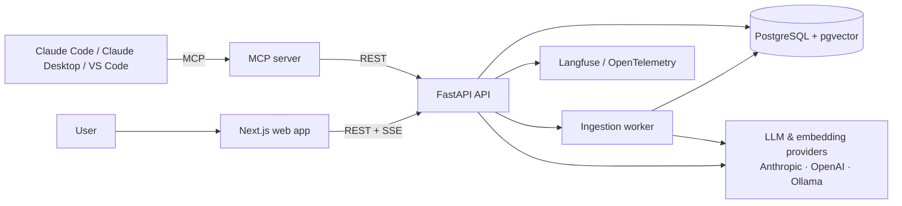

# Architecture

## Overview

## Request flows

**Ingestion.** Upload → store file → parse (keep pages and headings) → chunk with overlap → embed →
save chunks with their embeddings → mark the document `ready`.

**Question.** Question → hybrid search (full-text + vector, merged with Reciprocal Rank Fusion) →
top passages → if evidence is too weak, answer "I don't know" → otherwise the LLM answers using only those
passages and cites them by id → stream the answer and citations to the client.

**Agent.** For complex questions the model can call tools (`search_documents`, `get_document_section`,
`compare_documents`, `list_documents`) in a bounded loop before writing the final, cited answer.

## Key decisions

Record each one as an ADR in `docs/adr/` when it is implemented.

| Decision | Why |
| --- | --- |
| PostgreSQL + pgvector instead of a separate vector database | One database for data, full-text and vectors; simpler to run and to deploy on RDS |
| Hybrid search with Reciprocal Rank Fusion | Keyword search catches exact terms (article numbers, names); vectors catch meaning |
| Provider interface with several adapters | Free local development with Ollama; hosted models in production; easy to compare in evals |
| Own agent loop instead of a framework | Small, readable, fully tested; shows understanding of how tool calling works |
| MCP server as a separate package | Lumen becomes usable from other AI tools without coupling them to the web app |
| Evals in CI | Retrieval quality is measured on every change, not assumed |
| ECS Express Mode on AWS | App Runner is closed to new customers; Express Mode is the recommended simple path to Fargate |

## Security

- Document text is untrusted input: delimited in prompts and never followed as instructions
- Users can only access their own workspace (enforced in queries and tested)
- Secrets in environment variables locally and in AWS Secrets Manager in the cloud
- Uploads limited by size and type; files scanned for type by content, not extension
- Reference: OWASP Top 10 for Large Language Model Applications
